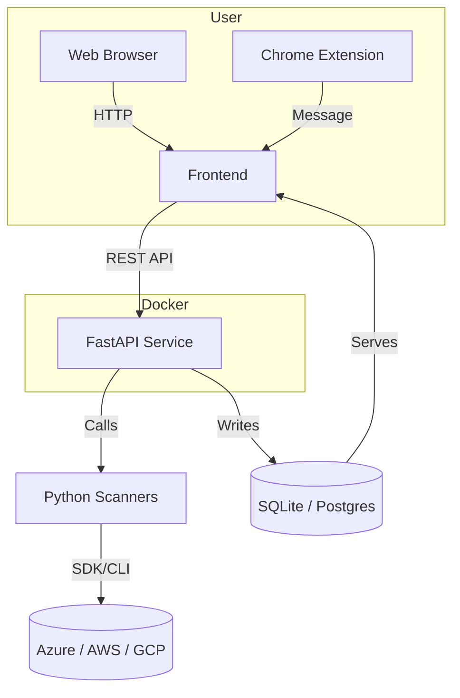

# Cloud Compliance Report

## Table of Contents
- [Overview](#overview)
- [Architecture](#architecture)
- [Directory Structure](#directory-structure)
- [Prerequisites](#prerequisites)
- [Setup & Installation](#setup--installation)
  - [Clone the Repository](#clone-the-repository)
  - [Backend (Python) Setup](#backend-python-setup)
  - [Frontend (Node) Setup](#frontend-node-setup)
  - [Browser Extension (Chrome) Setup](#browser-extension-chrome-setup)
  - [Docker (Optional)](#docker-optional)
- [Running the Application](#running-the-application)
  - [Start Backend API](#start-backend-api)
  - [Start Frontend UI](#start-frontend-ui)
  - [Trigger a Scan](#trigger-a-scan)
- [Configuration](#configuration)
- [Adding New Cloud Providers / Scanners](#adding-new-cloud-providers--scanners)
- [API Reference](#api-reference)
- [Testing](#testing)
- [Linting & Formatting](#linting--formatting)
- [CI / CD (GitHub Actions)](#ci--cd-github-actions)
- [Deployment Options](#deployment-options)
- [Troubleshooting](#troubleshooting)
- [Contributing](#contributing)
- [License](#license)
- [Acknowledgments](#acknowledgments)

---

## Overview

`cloud-compliance-report` is a **full‑stack** tool that scans cloud environments (Azure, AWS, GCP) for security‑ and compliance‑related misconfigurations, aggregates the findings, and presents them in an interactive web UI.  A lightweight Chrome extension can launch scans directly from the browser for ad‑hoc checks.

Key capabilities:
- Multi‑cloud scanning via pluggable Python modules.
- RESTful FastAPI backend exposing scan orchestration and result retrieval.
- React/Vite frontend with searchable tables, filters, and visual charts.
- Export of reports as JSON or static HTML.
- Extensible architecture – new providers are added by dropping a Python scanner module.
- Optional Docker image for easy production deployment.

---

## Architecture



- **Frontend** (`frontend/`) communicates with the backend via HTTP.
- **Backend** (`backend/`) runs a FastAPI server that orchestrates scanner modules.
- **Scanner modules** (`backend/*.py`) each implement a `scan()` function returning a list of findings.
- **Extension** (`extension/`) sends a Chrome‑runtime message to the frontend which forwards the request to the backend.
- Optional **Docker** compose bundles backend + frontend into containers.

---

## Directory Structure

```
cloud-compliance-report/
├─ backend/                # Python service
│   ├─ __init__.py         # Package marker
│   ├─ collector.py        # Orchestrates all scanner modules
│   ├─ main.py             # FastAPI entry point (uvicorn launch)
│   ├─ azure_scanner.py    # Example Azure scanner implementation
│   ├─ hud_scanner.py      # Placeholder for another provider
│   ├─ requirements.txt    # Python dependencies
│   └─ venv/               # Local virtual environment (git‑ignored)
│
├─ frontend/               # React / Vite UI
│   ├─ public/             # Static assets (logo, favicons)
│   ├─ src/                # React source code
│   │   ├─ components/     # Reusable UI components
│   │   ├─ pages/          # Route‑level pages
│   │   ├─ hooks/          # Custom React hooks (e.g., useScan)
│   │   └─ App.jsx
│   ├─ package.json        # npm scripts & dependencies
│   └─ vite.config.ts      # Vite configuration
│
├─ extension/              # Chrome extension
│   ├─ background.js       # Listens for toolbar clicks, forwards to UI
│   └─ manifest.json       # Extension manifest (v3)
│
├─ docker-compose.yml      # Optional Docker compose file
├─ Dockerfile.backend      # Backend Dockerfile
├─ Dockerfile.frontend     # Frontend Dockerfile
├─ .github/                # CI/CD workflow definitions
│   └─ workflows/ci.yml
├─ .gitignore
├─ README.md               # **This file**
└─ LICENSE
```

---

## Prerequisites

| Tool | Minimum Version | Reason |
|------|----------------|--------|
| **Python** | 3.12 | Backend implementation and scanner SDKs |
| **Node.js** | 20.x | Frontend build tooling (Vite) |
| **npm / pnpm / yarn** | any | Package manager for the UI |
| **Git** | any | Cloning the repository |
| **Docker** (optional) | 24.x | Containerised deployment |
| **Cloud SDKs** (Azure CLI, AWS CLI, gcloud) | optional | Helpful for local credential testing |

---

## Setup & Installation

### 1. Clone the Repository
```bash
git clone <REPO_URL> cloud-compliance-report
cd cloud-compliance-report
```

### 2. Backend (Python) Setup
```bash
# Create a virtual environment (if not already present)
python3 -m venv backend/venv
# Activate it
source backend/venv/bin/activate   # macOS / Linux
# Install dependencies
pip install -r backend/requirements.txt
```
> **Tip:** If `requirements.txt` is missing, you can generate it from the imports in the source files:
> ```bash
> pip freeze > backend/requirements.txt
> ```

#### FastAPI Development Server
```bash
uvicorn backend.main:app --reload --host 0.0.0.0 --port 8000
```
The API will be reachable at `http://127.0.0.1:8000`.

### 3. Frontend (Node) Setup
```bash
cd frontend
npm install   # or pnpm install / yarn install
```
Start the development server:
```bash
npm run dev   # Vite starts on http://localhost:5173
```
The UI automatically proxies API calls to `http://127.0.0.1:8000` (configured in `vite.config.ts`).

### 4. Browser Extension (Chrome) Setup
1. Open Chrome and navigate to `chrome://extensions/`.
2. Enable **Developer mode** (top‑right toggle).
3. Click **Load unpacked** and select the `extension/` folder.
4. The extension adds a toolbar button; clicking it opens a small popup that can trigger a scan via the frontend.

### 5. Docker (Optional)
A `docker-compose.yml` bundles the backend and frontend.
```bash
docker compose up --build
```
- Backend runs on port `8000`.
- Frontend runs on port `5173` (Vite dev server) or you can build a static site with `npm run build` and serve via Nginx.

---

## Running the Application

### Start Backend API
```bash
source backend/venv/bin/activate
uvicorn backend.main:app --host 0.0.0.0 --port 8000
```

### Start Frontend UI
```bash
cd frontend
npm run dev
```
Open `http://localhost:5173` in a browser.

### Trigger a Scan
You can launch scans from three entry points:
1. **Frontend UI** – click *"Run Scan"* and select a cloud provider.
2. **Chrome Extension** – click the extension icon → *"Run Scan"*.
3. **cURL / API client**:
   ```bash
   curl -X POST http://127.0.0.1:8000/scan \
        -H "Content-Type: application/json" \
        -d '{"provider": "azure", "options": {"subscription_id": "12345"}}'
   ```
   The response JSON contains a `report_id` you can later fetch:
   ```bash
   curl http://127.0.0.1:8000/report/<report_id>
   ```

---

## Configuration

The backend reads environment variables on start‑up (via **python‑dotenv**).  Create a `.env` file in the project root or export variables in your shell.

```env
# Azure credentials (service principal)
AZURE_CLIENT_ID=your-client-id
AZURE_CLIENT_SECRET=your-client-secret
AZURE_TENANT_ID=your-tenant-id

# AWS credentials (IAM user or role)
AWS_ACCESS_KEY_ID=AKIAxxxxxx
AWS_SECRET_ACCESS_KEY=xxxxxxxxxxxx
AWS_DEFAULT_REGION=us-east-1

# GCP credentials (service‑account JSON path)
GCP_PROJECT=my-gcp-project
GCP_CREDENTIALS=/path/to/gcp-sa.json

# General app configuration
LOG_LEVEL=INFO
REPORT_STORAGE_DIR=./reports   # where JSON reports are persisted
```
The backend loads these values using `os.getenv` and validates required ones for each provider.

---

## Adding New Cloud Providers / Scanners

1. **Create a new module** under `backend/`, e.g., `gcp_scanner.py`.
2. Implement a `scan(options: dict) -> List[dict]` function that returns a list of finding dictionaries, each with at least:
   ```python
   {
       "id": "unique-id",
       "title": "Short description",
       "severity": "LOW|MEDIUM|HIGH|CRITICAL",
       "resource": "arn:aws:s3:::my-bucket",
       "description": "Full explanation",
       "remediation": "What to change",
       "metadata": {"provider": "gcp", "region": "us-central1"}
   }
   ```
3. Register the scanner in `backend/collector.py`:
   ```python
   from . import gcp_scanner
   SCANNERS = {
       "azure": azure_scanner,
       "aws": hud_scanner,
       "gcp": gcp_scanner,
   }
   ```
4. Add any provider‑specific SDK dependencies to `backend/requirements.txt`.
5. (Optional) Add UI components under `frontend/src/components/<provider>/` to display provider‑specific fields.

---

## API Reference

| Endpoint | Method | Description | Request Body Example |
|----------|--------|-------------|----------------------|
| `/scan` | `POST` | Starts a new compliance scan. Returns `report_id`. | `{ "provider": "aws", "options": { "region": "us-east-1" } }` |
| `/report/{id}` | `GET` | Retrieves the JSON report for a completed scan. | – |
| `/health` | `GET` | Liveness probe – returns `200 OK` if the service is up. | – |

All endpoints return `application/json`. Errors follow the standard FastAPI error model (`detail` field).

---

## Testing

### Backend
```bash
pip install pytest pytest-asyncio
pytest backend/tests
```
Tests live in `backend/tests/` and cover each scanner module as well as the FastAPI routes.

### Frontend
```bash
cd frontend
npm run test   # Jest / Vitest test runner
```
Add new component tests under `frontend/src/__tests__/`.

---

## Linting & Formatting

- **Python** – `flake8` and `black`:
  ```bash
  pip install flake8 black
  flake8 backend/
  black backend/
  ```
- **JavaScript/TypeScript** – `eslint` and `prettier`:
  ```bash
  npm install -D eslint prettier
  npx eslint src/ --fix
  npx prettier --write src/
  ```
- **CI** runs these checks automatically (see CI/CD section).

---

## CI / CD (GitHub Actions)

The repository includes a workflow at `.github/workflows/ci.yml` that:
1. Checks out the code.
2. Sets up Python 3.12 and Node 20.
3. Caches `pip` and `npm` dependencies.
4. Runs linting, formatting, and unit tests for both backend and frontend.
5. Builds Docker images and pushes them to GitHub Container Registry (if a `GITHUB_TOKEN` with write permissions is present).

You can extend the workflow with deployment steps (e.g., Cloud Run, Azure Web Apps, Vercel) after successful tests.

---

## Deployment Options

| Platform | Steps |
|----------|-------|
| **Google Cloud Run** | `gcloud builds submit --tag gcr.io/<PROJECT>/cloud-compliance-report && gcloud run deploy --image gcr.io/<PROJECT>/cloud-compliance-report --platform managed --allow-unauthenticated` |
| **Azure App Service** | Build Docker image, push to Azure Container Registry, then create an App Service from the image. |
| **Vercel** (frontend only) | `vercel --prod` – configure Vercel to proxy `/api/*` to a separate backend deployment (e.g., Cloud Run). |
| **Docker Swarm / Kubernetes** | Use provided `Dockerfile.backend` & `Dockerfile.frontend` in your Helm chart or compose file. |

Make sure the deployment environment provides the required cloud credentials (via secret manager or environment variables).

---

## Troubleshooting

| Symptom | Likely Cause | Fix |
|---------|--------------|-----|
| **Backend fails to start – missing module** | `requirements.txt` out of sync | Re‑run `pip install -r backend/requirements.txt` or add missing packages. |
| **CORS errors in UI** | Backend not allowing origin `http://localhost:5173` | In `backend/main.py` ensure `CORSMiddleware` includes the dev origin. |
| **Extension click does nothing** | Extension not loaded or manifest version mismatch | Reload the extension page, verify `manifest.json` version = 3, and check Chrome console for errors. |
| **Scan returns empty result** | Credentials not set / wrong subscription ID | Verify env vars (`AZURE_CLIENT_ID`, etc.) and that the service principal has read permissions. |
| **Docker compose fails – port already in use** | Another process already listening on 8000 or 5173 | Stop the conflicting process or change ports in `docker-compose.yml`. |

For deeper logs, set `LOG_LEVEL=DEBUG` in `.env` and inspect `backend/logs/` (if configured) or the console output of `uvicorn`. 

---

## Contributing

1. **Fork** the repository and clone your fork.
2. Create a **feature branch**: `git checkout -b my-feature`.
3. Follow the **coding style** (black, eslint, type hints).
4. Write **unit tests** for any new functionality.
5. Run the full test suite locally: `pytest && npm run test`.
6. Commit with clear messages and push to your fork.
7. Open a **Pull Request** against `main`.
8. Ensure the CI workflow passes before merging.

If you need help with the architecture or want to propose a major change, open an issue first.

---

## License

This project is licensed under the **MIT License**. See the `LICENSE` file for full terms.

---

## Acknowledgments

- **FastAPI** – for a lightweight, async‑first web framework.
- **Vite** – rapid frontend development with hot‑module replacement.
- **Azure SDK for Python**, **Boto3**, **google‑cloud‑sdk** – core cloud provider libraries.
- The open‑source community for utilities such as **Zod**, **React**, and **Docker**.

---
